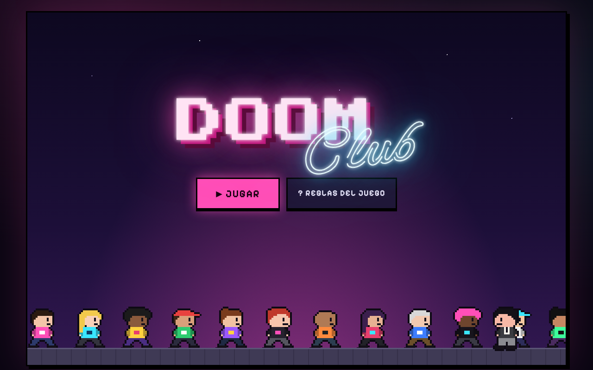
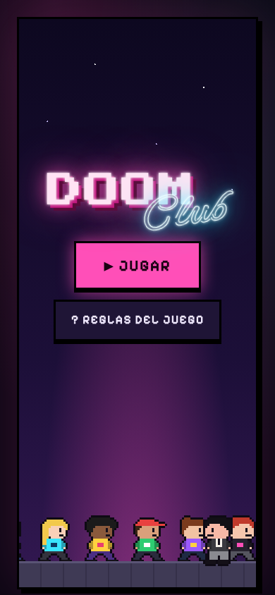
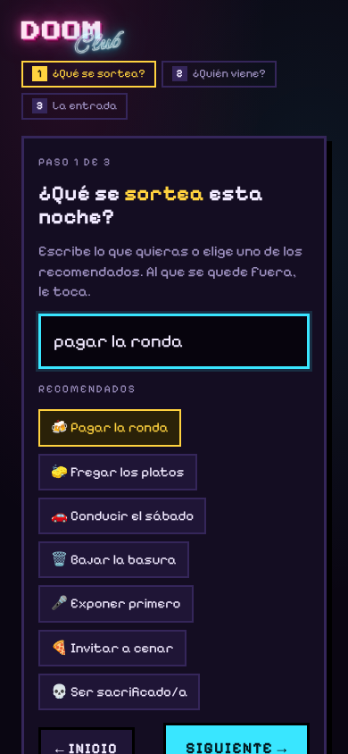
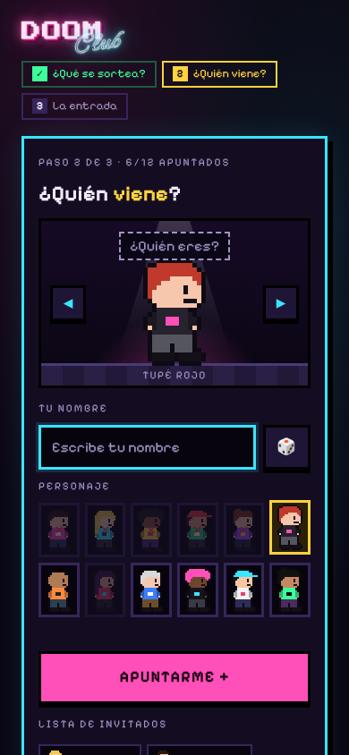
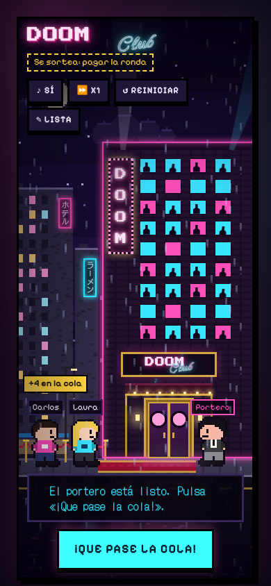
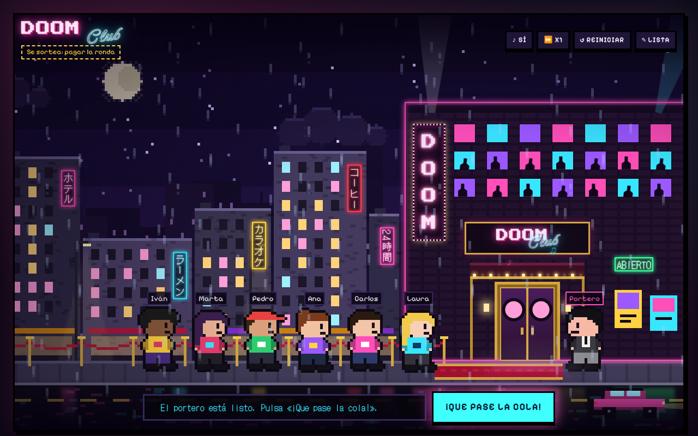

# Doom Club · Wheel of Doom

Sorteo **justo y aleatorio** con forma de discoteca en pixel art. La gente hace cola en la puerta de **Doom Club** y el portero deja pasar a todos… menos a uno. Al que se queda fuera **le toca** lo que se haya sorteado.



## Briefing

La asociación **Sacrificios SA** (organizadora de la purga, los juegos del hambre, el juego del calamar…) quiere una aplicación web para un nuevo evento de sacrificio de desarrolladores/as. La aplicación tiene que ser un sistema de sorteo **justo y aleatorio** a partir de una lista de nombres, y **no puede ser la típica ruleta**.

## Nuestra idea

En vez de una ruleta, hemos hecho la **puerta de una discoteca**:

1. **Pantalla de inicio:** el logo, el botón **Jugar**, las **Reglas del juego** y un desfile de personajes.
2. **¿Qué se sortea?:** se escribe libremente o se elige un recomendado (pagar la ronda, fregar, conducir, ser sacrificado/a…).
3. **¿Quién viene?:** cada persona elige uno de los 12 personajes y pone su nombre.
4. **La entrada:** la cola llega a la discoteca y, al pulsar **¡Que pase la cola!**, el portero mira uno a uno. Unos pasan, otros no… y puede vacilar a cualquiera, así que no se sabe quién va a caer.
5. Al que se queda fuera le sale una tarjeta con su nombre y **lo que le toca**. Se puede seguir jugando rondas hasta que no quede nadie. Al final sale la lista con el orden en que fueron cayendo y **Volver a jugar**.

Así sirve para el evento de Sacrificios SA y también para usarlo de verdad con amigos o en clase.

## Cómo se usa

1. Abre `index.html` en el navegador (no hace falta instalar nada).
2. Pulsa **Jugar** y sigue los pasos.

Atajos: **barra espaciadora** = ¡Que pase la cola! · botón **⏩ x2** = ir el doble de rápido.

## Tecnologías y herramientas

- **HTML, CSS y JavaScript** sin librerías.
- **Jest** para los tests unitarios.
- **Figma** para las maquetas y el prototipo.
- **Trello** para el tablero Kanban (historias de usuario y tareas).
- **Git y GitHub** para el control de versiones.
- **Visual Studio Code** como editor.

## Requisitos cumplidos

| Requisito | Cómo lo cumplimos |
|---|---|
| Recibir una lista de nombres | Paso "¿Quién viene?": nombre + personaje |
| Seleccionar un nombre | `pickRandomName()` elige al azar con `Math.random()` |
| Aviso con el nombre elegido | Tarjeta "¡TÚ NO!" con el nombre y lo que le toca |
| El elegido no vuelve a salir | Se quita de la lista con `removeName()` hasta reiniciar |
| Añadir y eliminar nombres | Botón **Apuntarme** y la ✕ de cada invitado |
| Animaciones y transiciones | Personajes andando, puerta que se abre, neones, lluvia, coches… |
| Eventos que activan animaciones | Clics, teclado (flechas y espacio) y formularios |
| Efectos de sonido | Web Audio API: bombo, silbato, rayada de disco, etc. |
| Pantalla de inicio | Logo + Jugar + Reglas del juego |
| Botón de reinicio | **↺ Reiniciar** en la discoteca |
| Aviso con el último eliminado | Tarjeta final "Se acabó la fiesta" con el orden |
| Volver al inicio al acabar | Botón **Volver a jugar** (o solo, a los 20 segundos) |
| Mobile first | El CSS está escrito primero para móvil |
| 2 puntos de quiebre | 600px y 1024px (`css/responsive.css`) |
| Tests | 18 tests con Jest en `tests/logic.test.js` |
| Bonus: horizontal | Media query `orientation: landscape` |
| Bonus: localStorage | Se guardan la lista, lo que se sortea y la partida |

## Estructura de carpetas

```
wheel-of-doom/
├── index.html          → las 4 pantallas y las tarjetas
├── css/                → atomic design
│   ├── base.css        → variables (colores, fuentes) y estilos generales
│   ├── atoms.css       → botones, inputs, etiquetas
│   ├── molecules.css   → logo, pasos (stepper)
│   ├── organisms.css   → intro, taquilla, escena, tarjetas
│   ├── animations.css  → todas las @keyframes
│   └── responsive.css  → puntos de quiebre
├── js/
│   ├── logic.js        → lógica del sorteo (funciones puras, sin DOM)
│   └── app.js          → personajes, escena, sonidos, pantallas y eventos
├── tests/
│   └── logic.test.js   → tests de Jest
├── assets/             → imágenes y sonidos
└── docs/               → capturas y planificación
```

## Atomic design

- **Átomos:** botón (`.btn`), input (`.input`), etiqueta (`.label`), sprite (`.sprite`).
- **Moléculas:** logo (`.logo`), pasos (`.stepper`), chip de sugerencia (`.chip`), invitado (`.guest`), bocadillo del portero (`.bubble`).
- **Organismos:** taquilla (`.taquilla`), escena de la discoteca (`.scene`), tarjetas (`.dialog`).
- **Páginas:** inicio, ¿qué se sortea?, ¿quién viene? y la entrada.

## Cómo funciona el sorteo (lo importante)

El sorteo se decide **antes** de la animación, en una sola línea:

```js
const chosen = pickRandomName(state.alive); // Math.random() sobre los que quedan
```

Después todo es animación: `buildRoundOrder()` mezcla la cola y coloca al elegido en una posición al azar. El portero duda con todos el mismo tiempo, así que la animación no da pistas. Por eso es **justo** (todos tienen la misma probabilidad) y **no se puede predecir**.

## Tests

```bash
npm install
npm test
```

Se testean las funciones de `js/logic.js`: elegir un nombre, añadir y quitar personas (con sus errores), fin de partida, mezclar la cola y elegir personaje libre.

## Maquetas

| Inicio | ¿Qué se sortea? | ¿Quién viene? | La entrada |
|---|---|---|---|
|  |  |  |  |



Enlace a Figma (maquetas de móvil, tablet y escritorio + guía de estilos): https://www.figma.com/design/5dIVC2pBxmCOX9Jepp1AGX

## Planificación

Trabajamos con **Scrum + Kanban** en 2 sprints de 2 semanas. Las historias de usuario y las tareas están en [docs/planificacion.md](docs/planificacion.md).

Enlace a Trello: _pendiente_
